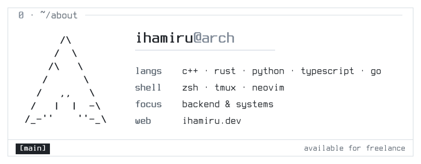

<picture>
  <source media="(prefers-color-scheme: dark)" srcset="banner-dark.svg">
  
</picture>

i'm ihamiru. backend and systems, mostly c# and python, with some typescript, c++ and lua. right now i run a c# / asp.net core backend on a linux server: postgres, docker, cloudflare in front. i like the windows side too: tracking down why an app keeps crashing, cleaning up what a pc starts at boot.

most of what i make is private, so github doesn't show much. [ihamiru.dev](https://ihamiru.dev) does: my projects, what i'm working on, and what's playing right now. if you live in a terminal, `curl ihamiru.dev` works too.

open to it support roles and freelance: contact@ihamiru.dev
